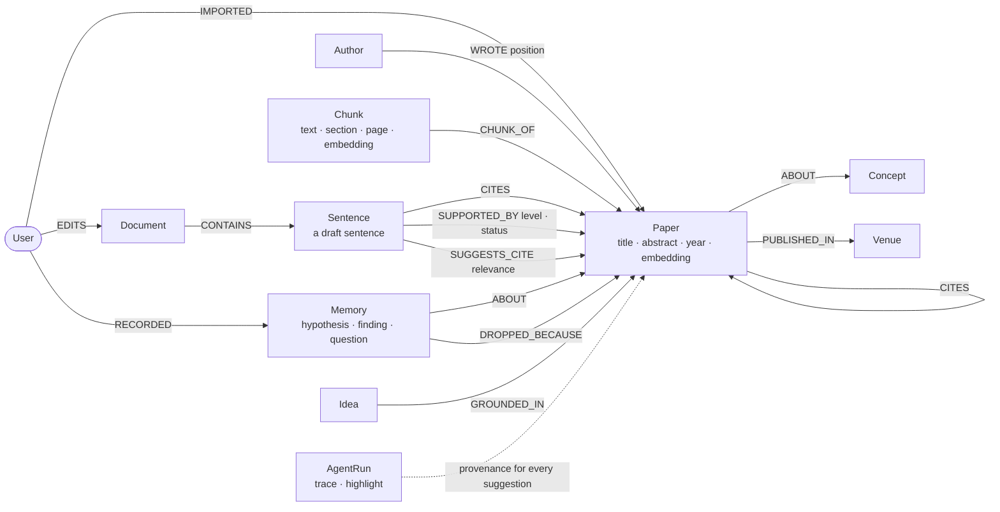
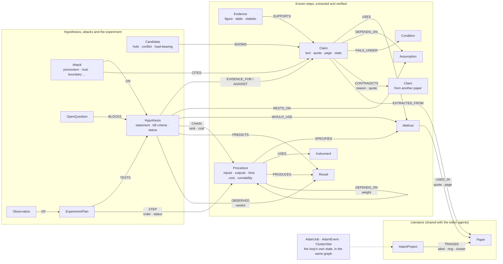

# Neura Query

**Hackathon submission: Adam, a research designer and experiment designer built on FalkorDB, inside a collaborative WYSIWYG research editor whose own agents run on the same graph.** 

Adam does the work that sits between a research question and a lab bench:

- **Scopes** the question into sub-questions and a search vocabulary.
- **Sweeps** the literature in rings (seed, citation, adjacent fields) and reads the core papers in full.
- **Extracts** every claim, method, assumption and piece of evidence with the page and quote it came from; a second agent verifies each one against the source before a person sees it.
- **Works up** each method into a procedure a lab could run: inputs, outputs, steps, equipment, time, cost.
- **Finds** the holes, conflicts and untested assumptions in what the field knows, using the graph's structure.
- **Writes** competing hypotheses and attacks them before you spend a day on one.
- **Designs** the experiment that would test the survivor: a chain of known procedures ordered cheapest-to-kill, with the gaps marked honestly.

You make the three decisions it cannot: the question, which hypothesis is worth your lab's time, and the result that would make you drop it. Then you run the experiment, record what you observed, and the verdict goes back into the graph for the next pass.

The graph is not a store beside the agent: it is Adam's memory, its job queue and its proof.

> **"New results are a combination of known steps. The novelty is in the assembly, not in inventing."**
>
> And the discipline that makes that usable: **no claim without the page it came from, and no hypothesis without the result that would kill it.**


> **Submission** · WeMakeDevs × FalkorDB Graph Hacks (Oct 15–18, 2026)

> **Tracks:** 01 Agents That Act on Connected Data (primary) · 02 Agent Memory and Coordination
> **Live:** _add URL_ · **Demo video:** _add URL_ · **Repo:** this one
> **Tooling disclosure:** Claude Code was used as a coding assistant throughout. The graph model, the Cypher templates, the agent design and the architecture were designed, reviewed and verified by the team; see [GRAPH_QUERIES.md](GRAPH_QUERIES.md) for every query the product depends on.

## The editor runs on the same graph

Adam lives inside **Neura Query**, a collaborative WYSIWYG research editor (TipTap, real-time multi-user). Every paper a team member imports or uploads goes into the workspace's FalkorDB graph first: OpenAlex metadata, references, authors, concepts, and the full text as section-aware passages with page numbers and embeddings. Small single-purpose agents then act on that graph while you write, and each suggestion carries the graph path behind it:

- **Cite Scout** suggests a citation for the sentence you're writing, drawn from *any* collaborator's library. Graph: hybrid vector + full-text search over `Paper` and `Chunk`, `(:User)-[:IMPORTED]->(:Paper)` to find whose library it came from, then a `CITES*1..2` path from the candidate to your own papers, shown with the suggestion.
- **Citation Checker** tells you whether each claim is supported, contradicted or uncited. Graph: vector search over the `Chunk` passages of the paper you cited, and only that paper, so the verdict is judged on what the cited source says.
- **Next-Step** proposes what to do next using only evidence from the graph. Graph: `algo.pageRank` over `CITES` for influential papers nobody on the team has read, concepts reached by the citation neighbourhood but absent from the library (gaps), papers cited by several collaborators' libraries (bridges).
- **Historian** keeps a time-aware research notebook, so a hypothesis the team dropped in March isn't suggested again in May. Graph: `Memory` nodes with a vector index and `validFrom` / `validTo`, plus `DROPPED_BECAUSE` edges to the paper that killed the idea.
- **Synthesis** drafts a literature review of the team's papers. Graph: `algo.labelPropagation` citation communities become the sections, PageRank orders the papers inside each one, and citations are restricted to the team's own papers.
- **Scout Watcher** flags new papers the team should know about. Graph: recent OpenAlex works citing two or more team papers, ranked by vector distance to the nearest team paper.
- **Ghost Writer** offers a grey inline continuation (Tab to accept), grounded in the passages Cite Scout found.
- **MCP server** (`/api/mcp`) gives Claude Code, Claude Desktop or Cursor the same graph tools the agents use, including Adam's `hypothesis_query`.

Agents only *propose*. Nothing is inserted until a person accepts it, so the researcher stays the author. Adam's extracted claims and the editor's citations point at the same `Paper` nodes, so a claim Adam verified is what the Citation Checker judges your draft against.

[Adam](#adam-the-research-agent-system) · [The Cypher and graph algorithms it depends on](GRAPH_QUERIES.md) · [Graph model](#graph-model)

---

## Why a graph

A research team's questions are about relationships: who read what, which paper supports which sentence and through which citations, which method a result depends on, which assumption three findings silently share, where a chain of procedures breaks. Similarity over passages answers none of those. Each one is a path, a count or a traversal, which is why the whole product, Adam and the editor agents alike, runs on one FalkorDB graph per workspace:

| Question | What it takes in FalkorDB |
|---|---|
| Which of **Bea's** papers supports the sentence **I** just wrote, and how does it connect to my reading? | Vector + full-text search, then `(:User)-[:IMPORTED]->(:Paper)` ownership, then a 1–2 hop `CITES` path to my own papers |
| Does the paper I cited actually say this? | Vector search over that paper's `Chunk` passages only, then a typed support judgement on each passage |
| What is the field around us working on that none of us has read? | `algo.pageRank` over `CITES`, concepts reached by the neighbourhood but not by the library, papers cited by several collaborators' libraries |
| How should a literature review of our papers be organised? | `algo.labelPropagation` citation communities, with PageRank ordering papers inside each one |
| Has anything new come out that builds on (or contradicts) our work? | Recent works citing ≥ 2 team papers, filtered by distance to the nearest team paper in the vector index |
| Didn't we already try this? | Vector search over `Memory` nodes with status `dropped`, plus the `DROPPED_BECAUSE` reason |

## Architecture

```
 Editor (TipTap + Yjs/Hocuspocus)            Research library · Graph page · Neura AI chat
   gutter cards · ghost text · check panel          │
          │                                         │
          ▼                                         ▼
 ┌──────────────────── Agent API routes (Next.js, Node runtime) ────────────────────┐
 │ cite-scout · citation-check · next-steps · ghost · memory · synthesis ·          │
 │ scout-watcher · router (/api/neura-ai) · graph views · MCP (/api/mcp)            │
 │ each agent: one job, fixed parameterised Cypher templates, AgentRun trace        │
 └───────┬────────────────────────────┬────────────────────────────┬────────────────┘
         ▼                            ▼                            ▼
   FalkorDB  ws:{workspaceId}     Typed judgements             DeepSeek V4 (prose) +
   one graph per workspace,       relevance / support / intent Cohere embeddings (1024-d,
   shared by every agent          as small structured calls    query vs document types)
         ▲
   Librarian pipeline: OpenAlex metadata + references + authors + concepts,
   PDF/DOCX full text → passages → embeddings (runs in `after()` on import)

 Postgres (Drizzle/Supabase): auth, workspaces, files (TipTap JSON), library rows
```

### Graph model

One FalkorDB graph per workspace. The research graph is what the editor agents read; Adam adds the layer of known steps on top of the same `Paper` and `Chunk` nodes, so a claim extracted by Adam and a citation suggested by Cite Scout point at the same paper node.

**The research graph** (library, full text, drafts, memory):



**Adam's layer** (every node carries `projectId`, a verification `state`, and the `quote`, `chunkId`, `page` and `section` it came from):



The chain a hypothesis query walks is `Result ← PRODUCES ← Procedure ← DEPENDS_ON* ← Procedure`; the provenance chain every answer resolves is `Claim → EXTRACTED_FROM → Paper` plus `chunkId → Chunk` for the quoted passage.

Properties and indexes per label are in [`src/lib/graph/schema.ts`](src/lib/graph/schema.ts). Draft sentences are `Sentence` nodes; a `Claim` is always a statement extracted from a paper.

The exact Cypher is in [`src/lib/graph/queries.ts`](src/lib/graph/queries.ts) and the indexes are in [`src/lib/graph/schema.ts`](src/lib/graph/schema.ts).

**FalkorDB features used:**
- **Multi-graph tenancy:** one graph per workspace, `ws:<workspaceId>`.
- **Vector indexes:** ten labels (`Paper`, `Chunk`, `Memory`, `ChatMessage`, `Claim`, `Method`, `Assumption`, `Procedure`, `Result`, `Hypothesis`), 1024-d cosine (Cohere `embed-english-v3.0`), queried with `db.idx.vector.queryNodes` and then pattern-matched in the same query.
- **Full-text indexes:** `Paper` title and abstract, `Chunk` text, `Claim` text, `Procedure` name.
- **Range indexes** on every id, `projectId`, state and dedupe key.
- **Graph algorithms:** `algo.labelPropagation`, `algo.WCC`, `algo.SPpaths` (weighted), `algo.pageRank`, `allShortestPaths`.
- **Variable-length paths** (`DEPENDS_ON*0..5`, `CITES*1..2`) and `UNION ALL` over labels.
- **The graph as the job queue:** an atomic claim (`MATCH … ORDER BY … LIMIT 1 SET …`), heartbeats and stale requeue, all as Cypher.
- **Rendering:** [`@falkordb/canvas`](https://www.npmjs.com/package/@falkordb/canvas) draws the Research graph page, the Knowledge canvas and the hypothesis map.

Every template, with where it is used, is in [`GRAPH_QUERIES.md`](GRAPH_QUERIES.md).

### Two rules every agent follows

1. **Provenance.**
   - Every result carries the graph path or passage behind it.
   - Every run is stored as an `AgentRun` with its step trace (tool, Cypher template, rows, ms) and the node IDs it used.
   - The Research graph page renders any run as a provenance tree.
2. **Proposals, not facts.**
   - Agent-written edges and nodes start with `status: 'suggested'` and `by: 'agent:<name>'`. They are promoted only when a person accepts them.
   - Grounding queries read accepted, ingested or user-created data, so agent guesses never pollute the knowledge base.

## The agents

| Agent | Its one job | Graph | Judgement |
|---|---|---|---|
| **Librarian** (pipeline) | Turn imports/uploads into graph nodes: OpenAlex metadata, references, authors (in byline order), concepts, full-text passages | `MERGE` templates, chunk vectors | – |
| **Cite Scout** | Citation suggestions for the sentence being written, from every collaborator's library | Hybrid search (paper vectors + passage vectors + full-text, RRF), owner lookup, `CITES*1..2` path to *your* papers, dropped-hypothesis check | probability: "needs a citation" gate, then rubric score: relevance of every candidate in one call |
| **Citation Checker** | Verdict per claim: supported / partly / contradicted / not supported / needs citation | Claim→cited paper, best passages *within the cited papers* | rubric score: support rubric on the passage, probability: for uncited claims |
| **Next-Step** | 3 grounded next steps (read / experiment / write / ask) | Literature gaps, bridge papers, PageRank-influential unread papers, open hypotheses | rubric score: novelty and feasibility |
| **Ghost Writer** | Grey inline continuation, Tab to accept | Cite Scout's top passages as context | probability: "worth continuing now" gate |
| **Historian** | Time-aware notebook: `/hypothesis`, findings, questions, why something was dropped | `Memory` vector index, `DROPPED_BECAUSE`, timeline | label: hypothesis / finding / question |
| **Synthesis** | Draft a literature review into a new document | CDLP communities + PageRank structure the sections; passages ground the prose; citations restricted to the team's papers | rubric score: topic relevance for scoped reviews |
| **Scout Watcher** | New papers the team should know about | OpenAlex works citing ≥ 2 team papers, then vector-index distance to the nearest team paper | probability: "contradicts the closest team paper" |
| **Router** | Send a chat message to the right agent | – | label: one of 8 intents |

**MCP server** (`/api/mcp`, read-only)
- **Tools:** `list_workspaces`, `search_team_library`, `find_papers`, `paper_neighbourhood`, `citation_path`, `research_frontier`, `team_memory`, and Adam's `adam_projects`, `paper_claims`, `methods_dossier`, `open_questions` and `hypothesis_query`.
- **Clients:** gives Claude Code, Claude Desktop or Cursor the same graph tools the agents use.

## Adam: the research-agent system

Adam is the flagship (how to run it, tab by tab, and what a pass costs: [`docs/adam-guide.md`](docs/adam-guide.md)). Its premise: **a new result is a new combination of known steps.** The literature is not a pile of papers to summarise; it is an inventory of known steps, each with known inputs, outputs and conditions. So Adam's product is a graph of known steps, dense enough that when a researcher states a hypothesis the system can answer which steps exist, which are verified, which are missing, and where the chain breaks.

It lives at `/dashboard/<workspace>/adam` and runs as a loop (question → sweep → extract → methods → connect → hypothesise → attack → experiment → read again), driven by an orchestrator that reads the graph's state and enqueues jobs. The jobs are `(:AdamJob)` nodes in the same FalkorDB graph, drained by `scripts/adam-worker.ts` (`pnpm adam`, included in `pnpm dev:all`).

| Agent | Its one job | Checked by |
|---|---|---|
| **Scoper** | The topic becomes a question page: hunch, sub-questions, vocabulary incl. neighbouring fields' terms, scope fence | Scope checker; the researcher approves (gate 1) |
| **Searcher** | Three rings (seed, citation backward+forward, adjacent fields) over OpenAlex; triage core / method / contradicts / background | Coverage check: are the core papers' key references present? |
| **Extractor** | One extraction card per paper from its section-aware passages: claims, evidence, methods, assumptions, limitations, gaps, each with a verbatim quote, page and section. Two independent cards for core papers | **Verifier**: the quote must be in the source (no model is asked otherwise), the section must match, a typed rubric judges the rest; disagreements between the two cards become conflicts |
| **Methods Hunter** | Each Method filled in to a Procedure a lab could run: inputs, outputs, steps, equipment, time, cost, reliability, from the paper's methods sections, supplements and linked READMEs/protocols | Runnability check (runnable / partial / unknown) and feasibility against the lab's constraints |
| **Graph Analyst** | Holes between related clusters, conflicts between opposite claims, load-bearing assumptions nobody tested | Sanity check: an edge needs more than vocabulary overlap |
| **Hypothesis Writer** | Two to four competing briefs with boundary, evidence for and against, prediction and kill criteria | **Falsifier** (sees the brief and the graph, never the writer's reasoning): pre-mortem, dependency attack, rival explanations, null and ablation, baseline replication, boundary probe. The writer answers in writing; a brief with an open fatal attack cannot proceed. The researcher selects briefs (gate 2) and signs kill criteria (gate 3) |
| **Experiment Designer** | The chain of procedures per surviving brief, cheapest-to-kill first, gaps marked, controls from the rivals | Design check: does each experiment test the kill criterion and not something adjacent? The researcher approves the plan |
| **Orchestrator** | Who runs next; stopping rules: saturation per cluster, budget, convergence, diminishing chains, human hold | The researcher can pause, resume, redraw scope, start the next pass |

**Hypothesis as a query** (the Experiments tab, the chat's Adam intent, and the `hypothesis_query` MCP tool): the researcher types a hypothesis; the system returns the evidence for and against each sub-claim with pages, the boundary (conditions and assumptions), candidate chains of procedures with each step's status, gaps (which re-prioritise the Methods Hunter), rival chains that reach the same result without the mechanism, and the cost to kill.

**The exception queue**: people see only what the Verifier flagged (conflicts, low confidence, load-bearing, unsourced), each beside its quoted passage, with approve / correct / reject / send back. Everything else is one click away for audit. A person's decision outranks every agent write.

**Full-text indexing** is the foundation: PDFs are chunked by section (not token count) with page numbers, figure and table captions as their own passages, supplements and linked artefacts as extra documents of the paper, and an access status per paper. See `src/lib/graph/document-index.ts`.

**OpenAlex**: keyless traffic is metered against a shared daily budget; set `OPENALEX_API_KEY` (free from openalex.org) in `.env.local` or sweeps and the Librarian degrade to rate-limit errors.

**Benchmark**: `scripts/adam-benchmark.ts <workspaceId> <projectId> <reviewOpenAlexId>` measures coverage against a review's reference list, writes an extraction sample for an expert to grade, and lists method completeness, the Analyst's candidates and the briefs.

### Where the judgements come from

Every *judgement* an agent makes (is this passage relevant, does it support the claim, is this sentence worth continuing, which intent is this message) is a typed question with a fixed answer shape: a probability, a rubric level or a label. They are answered by small structured calls, batched so that scoring eight citation candidates is one request, and the model writes prose only when prose is the output. Each helper has a fallback (embeddings, or a smaller structured call), so no single vendor is load-bearing.

## Running it locally

**Requirements:**
- Node 22+ and pnpm (PDF reading needs Node 22; on Node 20 Adam sees abstracts only).
- Docker (for FalkorDB).
- A Postgres database (Supabase works).
- A DeepSeek API key (text generation, `deepseek-v4-flash`) and a Cohere API key (embeddings).
- An OpenAlex API key (free from openalex.org). Keyless OpenAlex allows ~100 requests a day and one Adam sweep makes ~250.

```bash
pnpm install
cp .env.example .env.local        # fill in DATABASE_URL, AUTH_*, DEEPSEEK_API_KEY, COHERE_API_KEY, FALKORDB_URL, OPENALEX_API_KEY, …
docker compose up -d falkordb      # FalkorDB on :6379, FalkorDB Browser on http://localhost:3001
pnpm push                          # create the Postgres tables
pnpm dev:all                       # Next.js on :3000, the Hocuspocus collaboration server on :1414, and Adam's worker (nothing in Adam runs without it)
```

Sign in, create a workspace, then open **Research papers** to search OpenAlex or upload PDFs. Every paper you add is indexed into the workspace graph in the background.

### Demo data

The seed scripts build the hackathon demo: three collaborators with overlapping RAG/GraphRAG libraries, and a draft that exercises every agent.

```bash
run() { node --env-file=.env.local ./node_modules/tsx/dist/cli.mjs "$@"; }
run scripts/seed-graph.ts    <workspaceId>     # demo collaborators Bea and Chen + their papers
run scripts/seed-fulltext.ts <workspaceId>     # full-text passages for the seeded papers (arXiv PDFs)
run scripts/seed-draft.ts    <workspaceId>     # "GraphRAG literature review (draft)" in a Demo folder
run scripts/graph-report.ts  <workspaceId>     # what is indexed in FalkorDB, cross-checked with Postgres
run scripts/reembed.ts       <workspaceId|--all> # re-embed papers, passages and notes after changing the embedding model
```

### Using the MCP server

Set `MCP_TOKEN` (16+ characters) in `.env.local`, then:

```bash
claude mcp add --transport http neura http://localhost:3000/api/mcp --header "Authorization: Bearer $MCP_TOKEN"
```

## Where things are

| Path | What |
|---|---|
| `src/lib/graph/` | FalkorDB client, schema/indexes, all Cypher, the Librarian (`ingest.ts`, `document-index.ts`), document → claims sync, team search |
| `src/lib/agents/` | One file per agent, plus `base.ts` (runs, traces, proposals) and `router.ts` |
| `src/app/api/agents/*`, `src/app/api/graph/*`, `src/app/api/mcp` | Agent, graph-view and MCP endpoints |
| `src/components/novel/` | Editor integrations: Cite Scout panel, ghost text, citation check, notebook, draft review |
| `src/components/graph/research-graph-view.tsx` | Research graph page: team map, paper focus and agent provenance on `@falkordb/canvas` |
| `src/components/library/` | Research library: library, index health, OpenAlex search, new papers, upload/import |
| `src/lib/adam/`, `src/components/adam/`, `src/app/api/adam/`, `scripts/adam-worker.ts` | Adam: agents, phases, handlers, per-area Cypher, the five-step and advanced UIs, the API, the worker |
| [`GRAPH_QUERIES.md`](GRAPH_QUERIES.md) | **The Cypher queries and graph algorithms the product depends on**, with where each is used |

### Built during the hackathon vs. pre-existing

**Pre-existing:** the neura-query app itself (auth, workspaces, folders and files, the TipTap/Yjs collaborative editor, Zotero OAuth, the original bubble-menu AI and Stripe) was imported.

**Built during the hackathon:**
- Everything under `src/lib/graph`, `src/lib/agents` and `src/lib/citations.ts`.
- The agent, graph-view and MCP routes.
- The research library rebuild: OpenAlex search and import, full-text indexing, and index health.
- Every editor integration listed above.
- The Research graph page and the seed and report scripts.
- **Adam** : the research-agent system, its job queue in the graph, the worker, the hypothesis-as-query path search, the five-step UI, observations and verdicts. See [GRAPH_QUERIES.md](GRAPH_QUERIES.md).
- Upgrade to Next 16.
- Fixes to the editor plumbing it depended on:
  - slash commands and Tab indentation;
  - collaborator presence;
  - draft-wiping and cross-document autosave bugs.

### FalkorDB notes from building this

Engine quirks we hit and worked around:
- **Null lists:** returning a `collect()` list containing nulls crashed the server, so lists are filtered before they're returned.
- **Delete then merge:** `MATCH … DELETE … WITH count(*) … UNWIND … MERGE` silently created nothing, so it is split into two queries.
- **NUL bytes:** a NUL byte inside a string parameter fails the query, so text is stripped of control characters on ingest.
- **`shortestPath` placement:** `shortestPath` is accepted only in `WITH`/`RETURN`. `MATCH p = allShortestPaths(...)` after a `WITH` works for undirected citation paths.
